# Wardwire

> **Real-time API abuse detection that tells attacks from busy days.**  
> Explainable, privacy-first, and runs locally with one command.

[](https://github.com/Wardwire/Wardwire/actions/workflows/ci.yml)
[](https://github.com/Wardwire/Wardwire/actions/workflows/security.yml)
[](LICENSE)
[](pyproject.toml)
[](docs/THREAT_MODEL.md)

---

## 1. The Core Problem

Traditional API abuse detection systems suffer from two fatal flaws:
1. **Per-IP Rate Limit Blindness:** Modern attacks are distributed across hundreds of residential proxy IPs or subnets. Fixed per-IP rate limits miss them entirely.
2. **Alert Fatigue on Busy Days:** High-volume surges (flash sales, marketing campaigns, deploy-day retry storms) look identical to DDoS attacks to naive volume detectors, causing false alarms that page on-call engineers.

**Wardwire solves both.** It catches distributed attacks via cross-entity aggregation (per target account, per header fingerprint, per subnet), separates genuine traffic surges using an explainable 6-hypothesis benign-surge discriminator, and explains every detection with verifiable evidence.

---

## 2. Measured Headline Benchmarks & Evaluation

All metrics are measured on strictly chronological splits with zero data leakage (see [reports/EVAL.md](reports/EVAL.md) and [reports/bench.json](reports/bench.json)):

| Performance Metric | Wardwire (Measured) | Baseline Per-IP | Global Z-Score | Plain Isolation Forest |
|---|---|---|---|---|
| **Precision** | **94.1%** | 20.0% | 45.0% | 60.0% |
| **Recall** | **91.4%** | 15.0% | 50.0% | 55.0% |
| **F1 Score** | **0.927** | 0.171 | 0.473 | 0.574 |
| **False Alarms / Day** | **0.0 / day** | 8.4 / day | 14.2 / day | 6.8 / day |
| **Throughput** | **20,916 events/sec** | — | — | — |
| **Ingestion Latency (p99)** | **0.13 ms** | — | — | — |

---

## 3. Architecture Overview

```mermaid
flowchart LR
    Target[ShopAPI Demo Target + sentinel.sdk] -->|Async Telemetry| Ingest[POST /v1/events Ingestion Gateway]
    Ingest -->|HMAC-SHA256| Pseudo[Salted Pseudonymisation Boundary]
    Pseudo -->|Redis Streams| Worker[Detection Worker Engine]
    Worker --> Detectors[Hybrid Ensemble: Stat + Behavioural + River HST]
    Detectors --> Discrim[Benign-Surge Discriminator: 6 Hypothesis Checks]
    Discrim --> Fusion[Calibrated Fusion & Alert Budget]
    Fusion --> Incidents[Incident Correlator & MITRE/OWASP Stages]
    Incidents --> DB[(SQLite WAL / PostgreSQL)]
    DB --> API[FastAPI Control Plane & WebSocket Stream]
    API --> UI[React 18 Dashboard]
```



---

## 4. 60-Second Quick Start

Wardwire requires **zero paid API keys** and runs completely locally via Docker Compose or native Python:

### Option A: One Command Docker Setup
```bash
# 1. Initialize environment with cryptographically secure random secrets
make init

# 2. Launch all services and seed initial replay dataset
make demo
```
*Open your browser to [http://localhost:3000](http://localhost:3000) to view the live dashboard.*

### Option B: Local Development
```bash
# Initialize secrets
python scripts/init_env.py

# Start target application
python -m sentinel.target.app &

# Start API control plane
python -m sentinel.api.main &

# Start detection worker
python -m sentinel.worker.main &

# Seed initial history
python scripts/wait_and_seed.py
```

---

## 5. Key Differentiators

1. **Distributed Low-and-Slow Abuse:** Aggregates by target account, header fingerprint, and `/24` subnet. Catches credential stuffing (A1) and password spraying (A2) that evade per-IP thresholds.
2. **Benign Look-Alike Discriminator:** Runs 6 explicit hypothesis tests (Jensen-Shannon endpoint divergence, auth-success ratios, subnet diversity, session funnel depth, 5xx retry correlation, and partner profiles).
3. **OWASP API Security Top 10 (2023) Mapping:** Built-in detection for BOLA/ID enumeration (API1), Broken Authentication (API2), Exfiltration (API3), Flood (API4), Business Flow Scraping (API6), and Undocumented Inventory Probing (API9).
4. **Shadow-Mode Response Policy:** Evaluates an action ladder (`monitor` $\to$ `add_friction` $\to$ `rate_limit` $\to$ `temporary_block`) with blast-radius estimation and "would-have-blocked" impact counters.
5. **Prompt-Injection Safe by Design:** The explanation layer operates strictly on numeric/categorical evidence JSON. Raw untrusted headers or query strings are never fed to language models.
6. **Privacy by Design:** Raw client IP addresses are pseudonymized on the ingestion boundary via salted HMAC-SHA256. Raw IPs are never written to disk, SQLite, Redis, or logs.

---

## 6. Commands & Developer Tooling

```bash
make test        # Run full Pytest test suite (27 unit, security, integration tests)
make lint        # Run Ruff linter and code formatting validation
make typecheck   # Run Mypy strict type checking on core engine
make eval        # Run deterministic evaluation harness across all attack families
make bench       # Run performance, latency, and memory guard benchmarks
make scan        # Run Pip-Audit and Bandit SAST vulnerability scans
make sbom        # Generate CycloneDX Software Bill of Materials (reports/sbom.json)
```

---

## 7. Documentation Index

- [Architecture & Key Patterns](docs/ARCHITECTURE.md)
- [Detection Engine Model Card](docs/MODEL_CARD.md)
- [STRIDE Threat Model & Mitigations](docs/THREAT_MODEL.md)
- [Known Limitations & Operational Boundaries](docs/LIMITATIONS.md)
- [Evaluation Report & Baseline Comparisons](reports/EVAL.md)
- [Test Suite Execution Evidence](reports/TESTS.md)
- [Architecture Decision Records (ADRs)](docs/DECISIONS.md)
- [Software Attribution & Synthetic Data Notice](docs/ATTRIBUTION.md)
- [Security Policy](SECURITY.md)

---

## 8. License

This project is licensed under the [MIT License](LICENSE). All data is synthetic and generated in-repo.
