# Wardwire — System Architecture

## 1. Overview & Data Flow

Wardwire is engineered as an asynchronous, distributed-capable API traffic telemetry and abuse explanation system.

```mermaid
flowchart LR
    Target[ShopAPI Target + sentinel.sdk Middleware] -->|Async Batched JSON| Ingest[POST /v1/events Ingest API]
    Ingest -->|HMAC-SHA256| Pseudo[Pseudonymisation Boundary]
    Pseudo -->|XADD| Stream[(Redis Stream: sentinel:events)]
    Stream -->|XREADGROUP| Worker[Detection Worker Engine]
    Worker -->|Windows & Aggregation| Sliding[Sliding Windows 10s/1m/5m]
    Sliding --> Detectors[Hybrid Ensemble: Stat + Heuristic + River HST]
    Detectors --> Discrim[Benign-Surge Discriminator]
    Discrim --> Fusion[Calibrated Fusion & Alert Budget]
    Fusion --> Incidents[Incident Correlator]
    Incidents --> Storage[(SQLite WAL / PostgreSQL)]
    Storage --> API[FastAPI Query & WS Control Plane]
    API --> UI[React 18 Dashboard]
```

---

## 2. Component Layout

- **`sentinel.sdk.SentinelMiddleware`:** Drop-in ASGI middleware. Passively monitors HTTP calls, calculates header fingerprints (`hdr_hash`), buffers events in an async bounded queue, and flushes non-blocking batches.
- **`sentinel.api`:** FastAPI web service hosting `/v1/events` (ingest), REST query APIs, live WebSocket telemetry stream `/v1/stream`, Attack Lab scenario execution endpoints, Prometheus metrics `/metrics`, and ops healthchecks `/healthz`, `/readyz`.
- **`sentinel.worker`:** Background event processing loop consuming from Redis Stream (or in-memory buffer) via consumer groups. Executes 1-second evaluation ticks, runs sliding windows, and invokes detectors.
- **`sentinel.sim`:** Adversarial Attack Lab traffic generator simulating benign look-alikes (B1–B5) and multi-stealth attacks (A1–A9) targeting localhost with strict allow-list enforcement.
- **`sentinel.eval`:** Reproducible evaluation and benchmarking suite (`make eval`, `make bench`).
- **`web`:** React 18, TypeScript, Tailwind CSS, and Lucide dashboard.

---

## 3. Redis Key Patterns & Namespaces

All keys are namespaced with `sentinel:` and enforce mandatory TTLs:

| Key Pattern | Data Structure | TTL | Purpose |
|---|---|---|---|
| `sentinel:events` | Stream | Maxlen 50,000 | Ingest telemetry queue for worker consumer group |
| `sentinel:b:{bucket_sec}:{metric}:{entity}` | String / Counter | 360 seconds | 1-second resolution metrics across entities |
| `sentinel:hll:{bucket_sec}:{entity}` | HyperLogLog (`PFADD`) | 360 seconds | Memory-bounded unique cardinality tracking |
| `sentinel:base:{route}:{metric}` | Hash | 86,400 seconds | Running EWMA + MAD baseline profiles |
| `sentinel:seq:{principal}:{route}` | List (capped) | 600 seconds | Recent object IDs accessed for BOLA sequential analysis |

---

## 4. Scaling & Persistence Model

- **Database:** SQLite in WAL (Write-Ahead Logging) mode is used by default for zero-configuration, single-command reproducibility. Can be switched to PostgreSQL with zero code changes via `DATABASE_URL`.
- **Horizontal Worker Scaling:** Workers consume Redis Streams using consumer groups. Partitioning by entity hash ensures all events for a given IP or account flow to a consistent worker bucket without lock contention.
